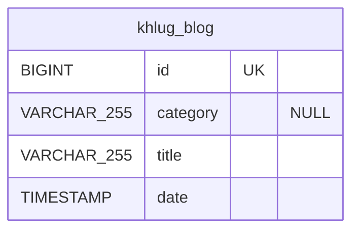

# Hello 블로그 최신 게시물 조회 Backend

## 작업 개요

랜딩을 포함한 내부 consumer가 Hello 블로그의 최신 게시물 목록을 조회할 수 있게 한다. Hello 블로그 게시물은 계속 Sight Legacy가 관리하며, Backend는 Legacy MySQL의 `khlug_blog`에서 최신 10개까지를 읽기 전용으로 조회한다. 성공 여부는 `SYSTEM` 권한을 가진 consumer가 최신 게시물의 식별자, 분류, 제목 및 게시일을 안정된 순서로 받을 수 있는 것으로 판단한다.

## 비즈니스 동작

- `SYSTEM` 권한을 가진 내부 consumer가 최신 Hello 블로그 게시물 목록을 요청한다.
- Backend는 `khlug_blog`에서 `date`가 최신인 게시물부터 반환하며, 동일한 `date`의 게시물은 큰 `id`를 먼저 반환한다.
- 반환 개수는 기본 10개이며, consumer는 1개 이상 10개 이하의 `limit`을 요청할 수 있다.
- 게시물이 없으면 성공적으로 빈 목록을 반환한다.
- 이 조회는 Hello 블로그 게시물의 생성, 수정, 삭제 및 상태 변경을 수행하지 않는다.
- 같은 요청을 반복해도 데이터 변경이나 추가 부작용 없이 당시 저장된 목록을 반환한다.

## HTTP API 계약

### GET /internal/hello-posts

Hello 블로그 게시물 collection을 조회한다. 게시물의 생명주기와 쓰기 권한은 Sight Legacy에 있으며, 이 endpoint는 Legacy가 소유한 공개 게시물 목록의 읽기 representation만 제공한다.

- Request header
  - `x-api-key`: 필수 string. `INTERNAL_API_KEY`와 일치해야 한다.
- Query string
  - `limit`: 선택 integer. 반환할 최대 게시물 수이며 기본값은 `10`, 허용 범위는 `1`부터 `10`까지다.
- Request body: 없다.
- Response body
  - `posts`: 필수 array. 최신순 Hello 블로그 게시물 목록이다.
  - `posts[].id`: 필수 integer. `khlug_blog.id`이며 랜딩 consumer는 `https://hello.khlug.org/{id}` 형식의 게시물 링크를 구성한다.
  - `posts[].category`: 필수 nullable string. 게시물 분류이며 저장된 값이 `NULL`이면 `null`이다.
  - `posts[].title`: 필수 string. 게시물 제목이다.
  - `posts[].date`: 필수 string. 게시 시각을 UTC ISO 8601 형식으로 나타낸다.

```json
{
  "posts": [
    {
      "id": 123,
      "category": "활동 기록",
      "title": "2026년 2학기 OT를 진행했습니다",
      "date": "2026-09-01T09:00:00Z"
    }
  ]
}
```

`GET` 요청은 `SYSTEM` 역할만 허용한다. API key가 없거나 유효하지 않으면 `401 Unauthorized`, 유효한 인증 주체에 `SYSTEM` 역할이 없으면 `403 Forbidden`을 반환한다. `limit`이 범위를 벗어나거나 정수가 아니면 `400 Bad Request`를 반환한다. 성공 시 `200 OK`를 반환한다. 데이터가 없는 경우도 `200 OK`와 빈 `posts` array를 반환한다.

이 API는 offset 또는 cursor pagination을 제공하지 않는다. 최대 반환 수가 10개로 고정되어 있고 consumer가 최신 게시물 일부만 조회하는 용도이기 때문이다. 정렬은 `date DESC, id DESC`로 고정하며 consumer가 변경할 수 없다. 읽기 전용 `GET`이므로 중복 요청과 재시도는 안전하다. 새 endpoint이므로 기존 API 계약은 변경하지 않는다.

## 데이터베이스 계약

`khlug_blog` schema, 데이터, index 및 제약 조건은 변경하지 않는다. Backend는 다음 기존 Legacy table을 읽기 전용으로 조회하며, JPA entity 또는 migration을 추가하지 않는다.



- 조회 대상은 Legacy MySQL의 `khlug_blog`이며, `id`, `category`, `title`, `date` column만 select한다.
- `id`는 table의 unique key이며, primary key는 추가하거나 변경하지 않는다.
- 정렬과 건수 제한은 `ORDER BY date DESC, id DESC LIMIT :limit`으로 적용한다.
- Native Query 결과는 읽기 전용 representation으로만 사용하며, `khlug_blog`에 대한 insert, update, delete를 수행하지 않는다.
- 신규 table, column, index, constraint, migration 또는 backfill은 없다. 따라서 구버전과 신버전 application이 함께 실행되어도 database 호환성 문제는 없다.

## 외부 시스템 계약

변경 없음. 이 endpoint는 Backend와 같은 MySQL instance의 기존 Legacy table을 읽는 database 접근이며, 별도 HTTP API, webhook 또는 message broker를 호출하지 않는다.

## 보안 및 개인정보

- endpoint는 기존 Internal API 인증을 사용하며, `x-api-key`가 `INTERNAL_API_KEY`와 일치해 `SYSTEM` 역할로 인증된 요청만 허용한다.
- 응답에는 게시물의 `id`, `category`, `title`, `date`만 포함한다. `author`, `content`, 생성·수정 시각 및 기타 Legacy 데이터는 반환하지 않는다.
- `x-api-key`는 server-side secret으로만 보관한다. consumer의 빌드 환경에서는 secret으로 주입하며, `PUBLIC_` 환경변수·클라이언트 코드·생성된 정적 HTML·log·metric·trace에 포함하지 않는다.

## 비가역적 부작용 및 운영 영향

- 읽기 전용 조회이므로 데이터 변경, 외부 알림, 비용 발생 호출, batch 또는 scheduler 실행은 없다.
- 호출당 최대 10행과 네 column만 조회한다. 방문자 요청이 아닌 내부 consumer의 갱신 시점 요청에만 사용한다.
- database 연결 또는 조회에 실패하면 `5xx` 응답을 반환하며, 실패 응답에 API key나 database 접속 정보를 포함하지 않는다.

## 호환성 및 배포

- 새 endpoint 추가이므로 기존 Backend API 및 Legacy의 Hello 블로그 동작은 변경하지 않는다.
- Backend 배포 후 consumer가 `GET /internal/hello-posts`와 `x-api-key`를 사용하도록 배포한다. consumer는 응답의 `id`로 Hello 게시물 URL을 구성한다.
- consumer가 `limit`을 생략하면 기본값 10이 적용된다. 기존 consumer는 없으므로 하위 호환을 위한 전환 단계는 필요 없다.
- rollback 시 consumer의 이 endpoint 호출을 중지한 뒤 Backend를 이전 버전으로 되돌린다. Legacy table에는 변경이 없으므로 database rollback은 필요 없다.

## 검증

- 서로 다른 `date`를 가진 10개 초과의 Legacy 게시물을 준비하고, 기본 요청이 최신 10개를 `date DESC, id DESC` 순서로 `200 OK`와 함께 반환하는지 repository·service·controller test로 확인한다.
- 동일한 `date`를 가진 게시물이 있을 때 큰 `id`가 먼저 반환되는지 확인한다.
- `limit=1`, `limit=3`, `limit=10` 요청이 각각 해당 최대 개수만 반환하고, `limit=0`, `limit=11`, 정수가 아닌 값이 `400 Bad Request`인지 확인한다.
- `category`가 `NULL`인 게시물이 응답에서 `category: null`로 반환되고, table에 게시물이 없으면 `posts: []`와 `200 OK`를 반환하는지 확인한다.
- 유효한 `x-api-key` 요청만 `SYSTEM` 역할로 허용되고, key가 없거나 잘못된 요청은 `401 Unauthorized`인지 확인한다.
- 기존 사용자 또는 운영진 인증만 가진 요청은 `403 Forbidden`인지 확인한다.
- 조회 후 `khlug_blog`의 행 수와 `id`, `category`, `title`, `date` 값이 변경되지 않는지 확인한다.

## 비목표

- Hello 블로그 게시물의 생성, 수정, 삭제, 상세 조회, category filtering 또는 Legacy에서 Backend로의 소유권 이전은 다루지 않는다.
- `khlug_blog` entity, table schema, primary key, index 또는 migration을 추가·변경하지 않는다.
- Landing의 빌드 시 API 호출, Cloudflare Pages Deploy Hook 호출 및 Hello 블로그 게시물 생성·공개 시 배포 갱신 트리거는 이 Backend Task에 포함하지 않는다.
