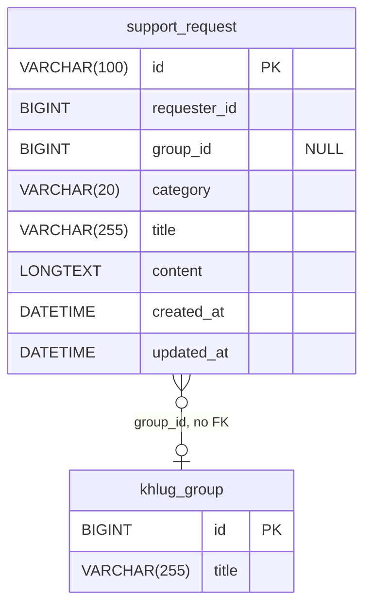

# 지원 신청 그룹 연결 Backend

## 작업 개요

회원이 지원 신청을 개인 신청으로 남기거나 자신이 속한 그룹에 연결해 등록할 수 있게 한다. Backend는 선택한 그룹의 존재와 신청자의 구성원 여부를 확인하고, 연결된 그룹 정보를 지원 신청 representation으로 제공한다. 기존 지원 신청은 개인 신청으로 유지한다.

## 비즈니스 동작

- `USER` 또는 `MANAGER` 역할의 회원은 지원 신청을 생성하거나 첫 댓글 전 자신의 지원 신청을 수정할 때 그룹을 선택하지 않거나 하나의 그룹을 선택할 수 있다.
- `groupId`가 제공되면 해당 그룹이 존재하고 신청자가 현재 그 그룹의 구성원이어야 한다. 그렇지 않으면 지원 신청을 생성하거나 수정하지 않는다.
- 그룹의 상태는 지원 신청 생성과 수정의 허용 조건이 아니다. Frontend는 진행 중인 그룹만 선택지로 표시하지만, Backend는 현재 또는 과거에 연결된 그룹이 종료되었다는 이유로 지원 신청을 거절하거나 연결을 제거하지 않는다.
- 그룹 연결은 지원 신청이 생성·수정된 시점의 선택을 저장한다. 이후 신청자가 그룹에서 탈퇴해도 기존 지원 신청의 그룹 연결은 유지한다.
- 그룹을 선택하지 않은 지원 신청과 기존 지원 신청의 `groupId`는 `null`이며 개인 지원 신청으로 취급한다.

## HTTP API 계약

### 공통 representation

`SupportRequest`와 `SupportRequestDetail`에 다음 `group` field를 추가한다. `group`은 연결된 그룹이 없으면 `null`이고, 연결된 그룹이 있으면 현재 그룹의 ID와 제목을 제공한다. 기존 식별자·시각·`requester` representation 규칙은 유지한다.

```json
{
  "id": "01JQ5J4ZAVY7YKA0GHRD33RHZG",
  "group": {
    "id": 123,
    "title": "사이트 개발 그룹"
  },
  "category": "SERVER_SPACE",
  "title": "프로젝트 서버 공간 지원 요청",
  "content": "배포 환경에 사용할 서버 공간이 필요합니다.",
  "requester": {
    "userId": 123,
    "name": "홍길동"
  },
  "hasComments": false,
  "createdAt": "2026-08-21T09:00:00Z",
  "updatedAt": "2026-08-21T09:00:00Z"
}
```

### POST /support-requests

기존 생성 계약에 선택 `groupId` field를 추가한다.

- Request body
  - `groupId`: 선택 nullable number. 연결할 그룹의 ID. 생략하거나 `null`이면 개인 지원 신청을 생성한다.

`groupId`가 존재하지 않거나 요청자가 해당 그룹의 현재 구성원이 아니면 `400 Bad Request`를 반환한다. 그룹 상태는 검증하지 않는다. 성공 응답은 `group` field를 포함한 `SupportRequest`를 반환한다. 나머지 인증, 입력, 성공·오류 status 및 멱등성 계약은 유지한다.

### GET /support-requests

기존 목록 조회 계약을 유지한다. 각 `SupportRequest`는 `group` field를 포함한다. 그룹 연결 여부로 목록을 필터링하지 않는다.

### GET /support-requests/{supportRequestId}

기존 상세 조회 계약을 유지한다. `SupportRequestDetail`은 `group` field를 포함한다.

### PUT /support-requests/{supportRequestId}

기존 수정 계약에 선택 nullable `groupId` field를 추가한다.

- Request body
  - `groupId`: 선택 nullable number. 연결할 그룹의 ID. 생략하거나 `null`이면 그룹 연결을 해제해 개인 지원 신청으로 변경한다.

수정 권한, 첫 댓글 존재 시 `409 Conflict`, 기존 입력 검증은 유지한다. `groupId`가 존재하지 않거나 신청자가 해당 그룹의 현재 구성원이 아니면 `400 Bad Request`를 반환한다. 그룹 상태는 검증하지 않는다. 성공 응답은 `group` field를 포함한 `SupportRequest`를 반환한다.

### DELETE /support-requests/{supportRequestId}

변경 없음

### POST /support-requests/{supportRequestId}/comments

변경 없음

### 유지할 계약

- 기존 `GET /groups`의 인증, pagination 및 `joined`, `state` query string 계약은 변경하지 않는다.
- 지원 신청의 열람, 댓글, 수정·삭제 권한과 Discord·사이트 내 알림 계약은 변경하지 않는다.

## 데이터베이스 계약



- `support_request.group_id`를 nullable `BIGINT` column으로 추가한다. default는 `NULL`이며 index와 foreign key constraint는 추가하지 않는다.
- `group_id` 값의 존재와 신청자의 현재 구성원 여부는 database constraint가 아니라 application에서 검증한다.
- 기존 지원 신청은 backfill하지 않고 모두 `group_id = NULL`로 유지한다.
- 그룹은 삭제하지 않는 도메인 규칙을 유지한다. 그룹 상태 변경이나 구성원 변경은 이미 저장된 `group_id`를 변경하지 않는다.
- nullable column 추가는 구버전 application과 호환된다. rollback 시 새 application 사용을 중지한 뒤 column을 제거할 수 있으며, 이미 저장된 그룹 연결 정보는 복구되지 않는다.

## 외부 시스템 계약

변경 없음. Discord 시스템 알림 Webhook과 운영진 댓글 DM payload에는 그룹 ID·제목을 추가하지 않는다.

## 보안 및 개인정보

- `groupId`가 제공되면 인증된 요청자의 현재 그룹 구성원 여부를 application에서 확인한다. Frontend의 선택지 제한만으로 다른 그룹에 지원 신청을 연결할 수 없게 해서는 안 된다.
- 모든 인증 회원은 기존 열람 권한에 따라 연결된 그룹의 ID와 제목을 지원 신청 목록·상세에서 확인할 수 있다.
- 그룹 상태는 접근 권한이나 지원 신청 연결의 유효성을 판단하는 데 사용하지 않는다.

## 비가역적 부작용 및 운영 영향

- 기존 지원 신청의 그룹 연결은 자동으로 생성하거나 변경하지 않는다.
- 그룹 연결을 변경해도 사이트 내 알림 또는 Discord 메시지를 추가로 전송하지 않는다.

## 호환성 및 배포

- 새 nullable column과 `group` response field는 기존 지원 신청 데이터를 유지하며, 구버전 client는 추가 response field를 무시할 수 있다.
- Backend가 `groupId`를 수용하고 `group`을 반환한 뒤 Frontend의 그룹 선택·표시 기능을 공개한다.
- 구버전 client가 `groupId` 없이 생성·수정하면 기존처럼 개인 지원 신청으로 처리한다.

## 검증

- 신청자가 속한 진행 중 그룹을 선택해 생성하면 `201` 응답과 목록·상세에 해당 그룹 ID·제목이 반환되는지 controller·service test로 확인한다.
- 신청자가 속한 종료 또는 중단 그룹을 `groupId`로 직접 요청해도 생성·수정이 허용되는지 확인한다.
- 존재하지 않는 그룹과 신청자가 속하지 않은 그룹의 `groupId`는 생성·수정 모두 `400`으로 거절되는지 확인한다.
- `groupId`를 생략하거나 `null`로 보내면 개인 지원 신청이 생성되고, 첫 댓글 전 수정에서 `null`로 변경하면 기존 그룹 연결이 해제되는지 확인한다.
- 그룹 연결 후 신청자가 탈퇴하거나 그룹 상태가 바뀌어도 기존 목록·상세가 연결된 그룹 정보를 계속 반환하고, 댓글·열람·수정·삭제의 기존 권한 규칙이 유지되는지 확인한다.
- migration 뒤 기존 지원 신청의 `group_id`가 모두 `NULL`이고 foreign key와 index가 생성되지 않는지 확인한다.

## 비목표

- 그룹별 지원 신청 목록 filtering API와 그룹 상세에서 지원 신청을 조회하는 API는 제공하지 않는다.
- 지원 신청에 여러 그룹을 연결하거나, 그룹 연결 변경에 따른 알림·Discord 메시지 발송은 제공하지 않는다.
